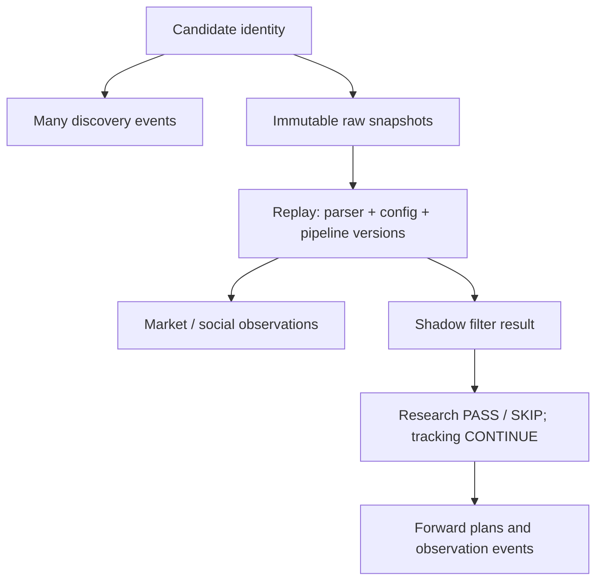

# Architecture

## Evidence and identity

Candidate identity is `(chain='solana', mint)` with a case-sensitive binary unique
constraint. Base58 must decode to 32 bytes; this validates syntax, not on-chain
existence. Candidate rows never change. Each candidate belongs to exactly one of
RESEARCH / VALIDATION / FINAL_OOS for this dataset. Discovery sources, timestamps,
event keys and metadata live in a separate table. Three sources produce three
events and one candidate, even with out-of-order delivery. A view derives first
and last observed time; candidate creation time means ingestion, not first discovery.

Raw payload bytes are the source of truth. They are never reconstructed from
normalized JSON. Snapshot metadata and payload commit atomically in the same DB.
UPDATE and DELETE triggers protect all durable evidence/version/lineage tables.
Recursive triggers plus the package's connection settings also prevent INSERT OR
REPLACE from silently deleting evidence. SHA-256 is checked on every snapshot read
and before replay. Metadata cannot be edited independently of the bytes.

## Transaction and failure model

Each public mutation uses BEGIN IMMEDIATE / COMMIT, with rollback on failure.
WAL, foreign_keys=ON, recursive_triggers=ON, synchronous=FULL, busy_timeout=15s.
Connections are not shared between threads; each worker uses its own Store.
Concurrent submissions serialize on SQLite's writer lock. No retry daemon exists.
Migrations run in one transaction; partial DDL is rolled back. Applied file checksum
mismatch, missing migration file, unknown target or downgrade is rejected.

Natural identities plus request hashes handle retries. Same key + same input returns
the existing row; same key + changed input raises IdempotencyConflict. Ingestion
clock time is deliberately excluded from request fingerprints. Explicit event or
capture keys must be stable across retries. Identical payload bytes captured in two
different requests remain two snapshots with equal payload hashes.

## Versioned replay

`raw_api_snapshots.id` + parser version + config version + pipeline version uniquely
identify a replay. A new version produces a new append-only run, preserving old
normalized observations and filter results. Config JSON is canonicalized with sorted
keys, compact separators, UTF-8 and no NaN/Infinity (q-json-v1, not RFC 8785).

Parser versions bind provider/name/version to implementation SHA-256 and mapping
status. The registry verifies the exact class source hash before invocation. Pipeline
manifests pin parser id, shadow filter class hash, foundation source/migration hashes,
Python version and SQLite version. Same semantic version with different content is
rejected. Old runs require the matching archived runtime/source, not a silent upgrade.

The parser receives original bytes and persisted metadata. Parse exceptions create
PARSE_ERROR runs without invented fields; arbitrary exception text is not stored.
Filter exceptions roll back the whole run. No partial market/filter/decision rows
remain. Parser errors are represented in replay details; api_events is the separate
transport/provider event stream and is not automatically populated by replay.

All real provider adapters are UNCONFIRMED. Registration of a CONFIRMED real-provider
parser is blocked in this phase; so is any normalized data from a real-provider
adapter. Synthetic parsers/threshold filters are test-only. There is no Grok decision
path. Config evaluation is not threshold optimization.

## Shadow filter and forward observations

Filter outcomes PASS / FAIL / SKIP / UNCONFIRMED are preserved. Decisions are strictly
RESEARCH_SHADOW: PASS only for a PASS filter, otherwise SKIP. Every result and decision
has research_tracking=CONTINUE, enforced by CHECK constraints. FAIL never terminates
tracking. UNCONFIRMED/parse-error runs get UNCONFIRMED filters and SKIP decisions.

`plan_forwards(decision_id)` explicitly inserts seven PLANNED events for either PASS
or SKIP: 600, 1800, 3600, 10800, 21600, 43200 and 86400 seconds. Anchor is the immutable
research decision timestamp, not the discovery timestamp. Repeated planning is
idempotent. No scheduler invokes this method automatically.

RECORDED/MISSING events append to a plan rather than modifying it. Due time must
match the decision anchor plus horizon. Recorded time cannot precede due time;
RECORDED requires a same-candidate/partition raw snapshot captured between due and
recorded time. There is no silent nearest-price choice. Multiple observed events can
exist per horizon; a future selection/quality policy remains undefined.

## Partitions and temporal semantics

Composite foreign keys propagate `(candidate_id, partition_id)` through raw → replay
→ observations/filter → decision → forward observations. A candidate cannot reappear
in a different partition. API events may be global within one partition; if linked to
a snapshot, provider/candidate/partition must match. Cross-partition joins for analyses
and access policy are future concerns; SQLite is not an authorization boundary.

All canonical timestamps are signed UTC Unix microseconds stored as INTEGER. Conversion
requires timezone-aware ISO strings/datetime. Naive datetimes and numeric timestamps
without declared units are rejected. Formatting yields `YYYY-MM-DDTHH:MM:SS.ffffffZ`.
No floating-point epoch conversion is used. Separate clocks: occurred, captured,
ingested, replay/decision creation, forward due and recorded. Provider timestamps are
not mapped yet. `market/social.observed_at_us` currently means raw capture time, not
verified market-event time; this distinction must survive later field integration.
